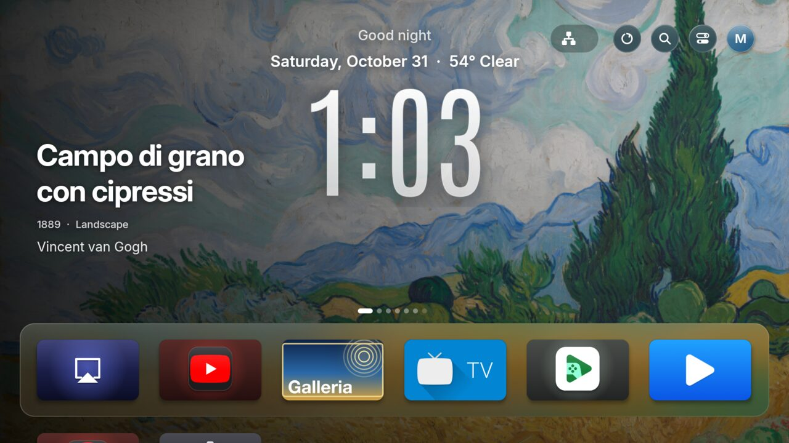

# Lume Suite

[English](README.md) · [Italiano](README.it.md) · [Español](README.es.md) · [Deutsch](README.de.md) · [Français](README.fr.md) · [Português](README.pt.md) · [简体中文](README.zh.md) · [हिन्दी](README.hi.md) · [日本語](README.ja.md) · [한국어](README.ko.md) · [العربية](README.ar.md) · [Русский](README.ru.md) · [Türkçe](README.tr.md) · [Bahasa Indonesia](README.id.md)

**Una TV più serena.** Apri un'app sul computer: trova la TV da sola, installa una Home pulita e spegne ciò che la rallenta o ti osserva. Non cancella nulla e si può annullare tutto. Niente agenti di codice, niente riga di comando, niente account.

## Come iniziare (3 passi)

1. **Scarica l'app per il tuo computer** (TV e computer sulla stessa Wi-Fi): [Mac con chip Apple](https://github.com/GPire/lume-suite/releases/latest/download/TV-Doctor-mac-apple-chip.zip) · [Mac Intel](https://github.com/GPire/lume-suite/releases/latest/download/TV-Doctor-mac-intel.zip) · [Windows](https://github.com/GPire/lume-suite/releases/latest/download/TV-Doctor-windows.exe) · [Linux](https://github.com/GPire/lume-suite/releases/latest/download/TV-Doctor-linux.tar.gz). Su Mac: decomprimi e **clic destro su "TV Doctor" > Apri**. Su Windows: doppio clic, e se compare l'avviso **Ulteriori informazioni > Esegui comunque** (l'avviso c'è perché l'app non è firmata a pagamento, non perché ci sia un problema: il codice è qui).
2. **L'app si apre nel browser e cerca la TV da sola.** Se serve, attiva *Opzioni sviluppatore > Debug USB/di rete* sulla TV: ti mostra come.
3. **Premi il pulsante grande.** Riconosce marca, modello, anno e sistema, installa Lume, Ambient Cast e Galleria e spegne le app inutili. Scegli tu cosa tenere (assistente vocale, trasmissione...). Si annulla tutto dalla stessa pagina.

*Preferisci una riga?* Mac/Linux: `curl -fsSL https://gpire.github.io/lume-suite/install.sh | sh` · Windows PowerShell: `irm https://gpire.github.io/lume-suite/install.ps1 | iex`. Oppure apri **https://gpire.github.io/lume-suite/**.

Qualcosa non va? Nell'app c'è *Segnala la tua TV*: prepara la segnalazione, tu la leggi su GitHub e premi Invia. Nulla viene disinstallato dalla TV: le app vengono solo disattivate.

[English: full details, status and licences](README.md)
