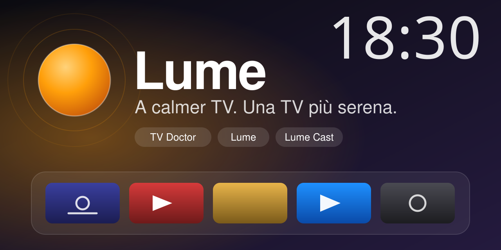
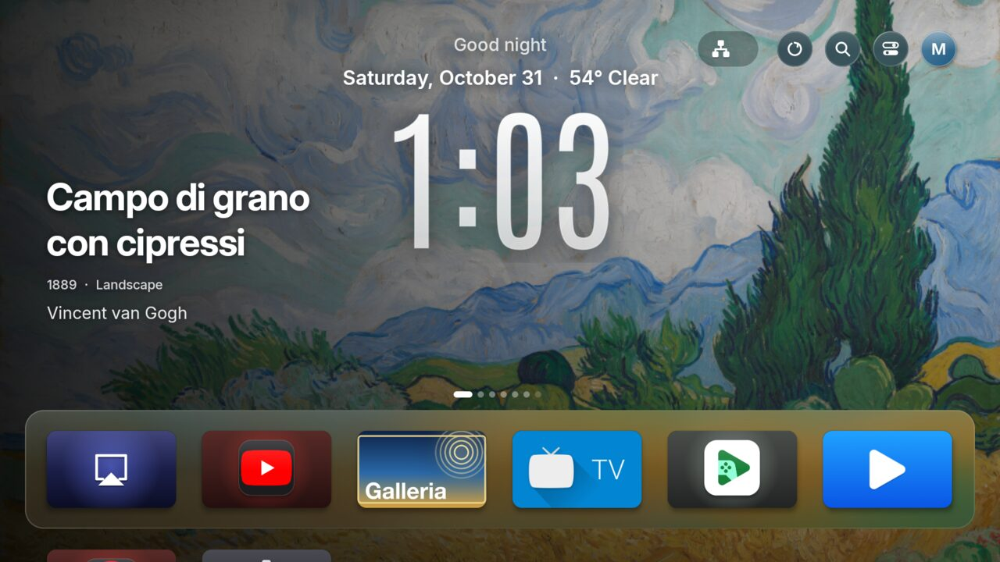
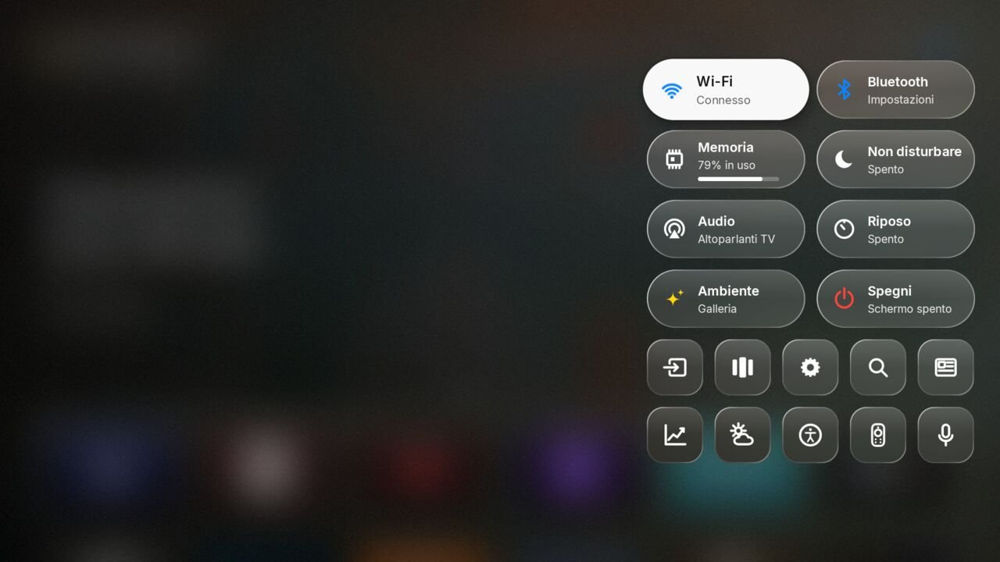
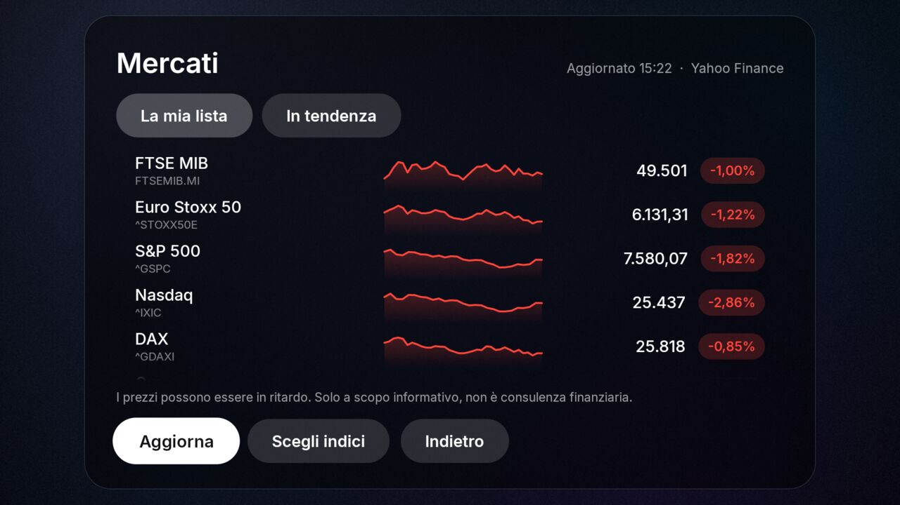

<h3 align="center">TV Doctor · Lume · Lume Cast: one calmer TV, for Fire TV, Google TV and Android TV</h3>

  
  

  <a href="README.md">English</a> · <a href="README.it.md">Italiano</a> · <a href="README.es.md">Español</a> · <a href="README.de.md">Deutsch</a> · <a href="README.fr.md">Français</a> · <a href="README.pt.md">Português</a> · <a href="README.zh.md">简体中文</a> · <a href="README.hi.md">हिन्दी</a> · <a href="README.ja.md">日本語</a> · <a href="README.ko.md">한국어</a> · <a href="README.ar.md">العربية</a> · <a href="README.ru.md">Русский</a> · <a href="README.tr.md">Türkçe</a> · <a href="README.id.md">Bahasa Indonesia</a>

---

**A calmer TV.** Open one app on your computer: it finds your TV by itself, installs a clean home screen, and switches off what slows it down or watches you. Nothing is deleted and everything can be undone. No coding agent, no command line, no account.

## Start here (3 steps)

1. **Download the app for your computer** (the TV and the computer must be on the same Wi-Fi):

   | Your computer | Download | Then |
   |---|---|---|
   | Mac (Apple chip: M1, M2, M3, M4) | [TV-Doctor-mac-apple-chip.zip](https://github.com/GPire/lume-suite/releases/latest/download/TV-Doctor-mac-apple-chip.zip) | unzip, **right-click "TV Doctor" > Open** |
   | Mac (Intel) | [TV-Doctor-mac-intel.zip](https://github.com/GPire/lume-suite/releases/latest/download/TV-Doctor-mac-intel.zip) | unzip, **right-click "TV Doctor" > Open** |
   | Windows | [TV-Doctor-windows.exe](https://github.com/GPire/lume-suite/releases/latest/download/TV-Doctor-windows.exe) | double-click; if Windows warns, **More info > Run anyway** |
   | Linux | [TV-Doctor-linux.tar.gz](https://github.com/GPire/lume-suite/releases/latest/download/TV-Doctor-linux.tar.gz) | unpack, run **TV Doctor** |

   The first time, Mac and Windows say the app is from an unknown developer. That is because it is not paid-for-signed, not because anything is wrong: each file has a `.sha256` next to it, and the full source is in this repository.
2. **The app opens in your browser and looks for your TV on its own.** If it asks, switch on *Developer options > USB / network debugging* on the TV; it shows you how.
3. **Press the big button.** It recognises the brand, model, year and system, installs Lume, Lume Cast and Lume Gallery, and switches off the useless apps. You choose what to keep (voice assistant, casting...). Everything can be undone from the same page.

*Prefer one line?* Mac/Linux: `curl -fsSL https://gpire.github.io/lume-suite/install.sh | sh` · Windows PowerShell: `irm https://gpire.github.io/lume-suite/install.ps1 | iex`. Or open **https://gpire.github.io/lume-suite/**.

**From the TV alone, no computer** (Fire TV, Android TV, Google TV, and the easy way if you are on your phone): on the TV install the free **Downloader** app and type `gpire.github.io/lume-suite/tv` (typing is easier with the free *Fire TV* or *Google TV* app on your phone: it has a keyboard). Pick **Lume**, then open it: a guide takes you through *Developer options*, the one *Allow* question and the cleaning, then connects the Gallery as screensaver, the Home button and AirPlay. Lume reads by itself whether each switch is on and moves on. You can also do the whole cleaning from your phone: *Lume > Settings > Phone control* shows a code and a QR; on the phone page the **Clean** tab shows the same steps, what to keep, *Clean now* and *Undo*. Same lists as TV Doctor, with an Undo. Tried on an Android 14 TV image; on a real Fire TV it reaches the *Allow* box.

**What you do yourself, TV by TV**

| TV | You do |
|---|---|
| Fire TV Stick / Fire TV | Press the Fire TV name 7 times (Settings > My Fire TV > About), turn on *ADB debugging*, answer *Always allow*. Lume opens the right page for you. |
| Google TV / Android TV, Android 10 or older | Press *Build* 7 times, turn on *USB debugging*, answer *Always allow*. |
| Google TV / Android TV, Android 11 or newer (Wireless debugging only) | A computer once, on the same Wi-Fi: TV Doctor finds the TV and asks for the 6-digit pairing code. |
| Samsung, LG, Roku, Hisense | Apps cannot be removed from outside. TV Doctor shows what to switch off for your model and year, and checks whether your network blocks ads (router DNS to AdGuard). |

**Samsung, LG, Roku, VIDAA** are closed systems: TV Doctor tells you what is and is not possible for your model and year ([details](docs/GOOGLE_TV_AND_TIZEN.md)). An HDMI stick gives these TVs the full experience.

**Something wrong?** The app has a *Report your TV* link: it prepares the report, you read it on GitHub and press Submit. Every report makes the next TV work better.

## What is inside

- **TV Doctor** recognises the TV (brand, model, year, system), turns off what slows or watches you in small safe groups, checks the TV still answers after each group (and undoes the group if not), and keeps a backup so you can go back. Fire TV, Google TV and Android TV: lists from the community plus brand sets (TCL, Sony, Xiaomi, Nvidia). It can also replace the stock Google TV home with Lume, if you choose to.
- **Lume** is a home screen for Android TV, Google TV and Fire TV: a big glass clock, a dock of sharp cards, Control Center, Recent Apps, markets, news, weather in several cities, a health page, three looks (glass, graphite, high contrast), the TV's own voice assistant, and full control from a phone.
- **Lume Cast** is an AirPlay receiver with Apple Music-style lyrics and screen mirroring, so an iPhone can show music and video on the TV.

### The phone as a remote

In Lume: Control Center, then the phone button. Scan the code, type the number: the page that opens is an Apple TV Remote-style surface (swipe to move, tap to choose, hold for Menu), with volume, play/pause, apps and favourites, search on the TV, YouTube or the web, profiles, and one-tap scenes (Cinema, Night, Music). To open apps and search while you watch something else, allow **Open apps from your phone** (TV Doctor and "Optimize this TV" do it for you). To type into other apps and use Back from them, switch Lume on in the TV's Accessibility settings once.

 

Release files are signed with this project's key (certificate SHA-256 `09:9C:A1:B2:91:12:0A:BF:2C:B2:EB:79:9B:76:81:58:3D:3C:52:E4:00:91:1B:A0:83:3F:2A:CA:A1:92:A7:B6`) and listed with their checksums in `SHA256SUMS`.

## What works today (honest status)

| Part | Tested on | Notes |
|---|---|---|
| TV Doctor on Fire TV | Real: Fire TV Stick 4K Max (Fire OS 8.1) | Full cycle: find, plan, apply in safe groups, check, undo |
| TV Doctor on Google TV / Android TV | A real Android TV 14 system image (emulator) and 8 simulated brands | Detect, clean, undo, Home replacement, reboot: verified. No physical Google TV yet |
| TV Doctor on Samsung, LG, Roku, VIDAA | Guides only | These systems are closed: it explains what is possible, per year |
| Lume | Real Fire TV Stick 4K Max; Android TV 14 image | Setup, Home, Control Center, markets, news, weather verified |
| Lume Cast | Real Fire TV Stick 4K Max | AirPlay music and mirroring need testing with more iPhones; synced lyrics and Sing mode not yet checked on a real song |
| Phone remote | Real Fire TV Stick 4K Max, driven from a computer | Pairing, apps, search and volume verified. The voice assistant button cannot be verified: Alexa starts listening only from the remote's own button. Not yet tried on a Google TV |

Details in [docs/DEVICE_SUPPORT.md](docs/DEVICE_SUPPORT.md) and how we compare with similar projects in [docs/COMPARISON.md](docs/COMPARISON.md).

## Languages

The interface is available in English, Italian, Spanish, German, French and Portuguese. More are on the way; see [CONTRIBUTING.md](CONTRIBUTING.md) to help translate.

## Before you rely on it

This is early software, tested on one real device. Read [docs/LAUNCH_READINESS.md](docs/LAUNCH_READINESS.md) for the honest list of risks and [docs/PRIVACY.md](docs/PRIVACY.md) for what leaves your network. TV Doctor only turns apps off and can undo everything, but it is provided without warranty.

## Licences

Each part has its own licence, listed in [LICENSE.md](LICENSE.md). Lume is derived from Hume Launcher by Petrobot (Apache-2.0) and Lume Cast from CastBay by weenas (GPL-3.0); credits in [NOTICE.md](NOTICE.md).
