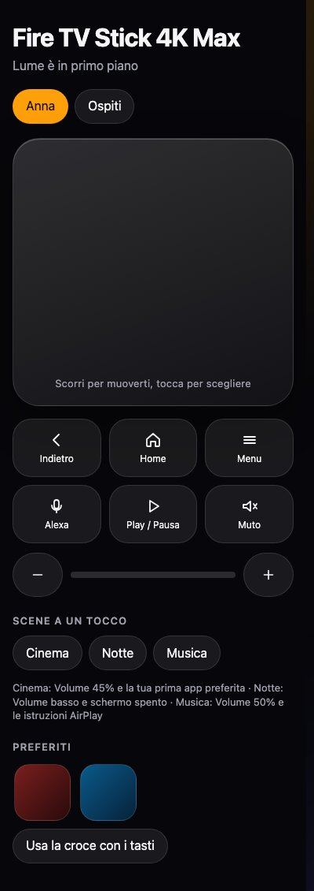

# Lume Suite

[English](README.md) · [Italiano](README.it.md) · [Español](README.es.md) · [Deutsch](README.de.md) · [Français](README.fr.md) · [Português](README.pt.md) · [简体中文](README.zh.md) · [हिन्दी](README.hi.md) · [日本語](README.ja.md) · [한국어](README.ko.md) · [العربية](README.ar.md) · [Русский](README.ru.md) · [Türkçe](README.tr.md) · [Bahasa Indonesia](README.id.md)

Daha sakin bir televizyon. Birlikte çalışan üç parça: **TV Doctor** (tek tuşla TV'yi temizler ve ayarlar, kod gerekmez), **Lume** (Android TV, Google TV ve Fire TV için ana ekran) ve **Lume Cast** (şarkı sözleri ve ekran yansıtma sunan AirPlay alıcısı).

## Nasıl başlanır

1. Depoyu indirin (**Code**, ardından **Download ZIP**) ve arşivden çıkarın.
2. `tv-doctor` klasöründe **TV Doctor.command** (Mac) veya **TV Doctor.bat** (Windows) dosyasına çift tıklayın; Linux'ta `./tv-doctor.sh` çalıştırın.
3. Ekrandaki adımları izleyin: TV'yi bulur, neyi değiştireceğini gösterir ve onayınızı bekler. Her değişiklik aynı sayfadan geri alınabilir.

TV'den hiçbir şey kaldırılmaz: uygulamalar yalnızca devre dışı bırakılır.

[English: full details, status and licences](README.md)

### Telefon kumanda olarak

Lume’da: Kontrol Merkezi, sonra telefon düğmesi. Kodu tarayın, sayıyı yazın: Apple TV kumandası tarzında bir yüzey açılır (hareket için kaydırın, seçmek için dokunun, Menü için basılı tutun); ses, uygulamalar, arama, profiller ve tek dokunuşluk sahneler vardır. “Telefondan uygulama aç” iznini bir kez verin (TV Doctor bunu sizin için yapar).

Yardımcı olduysa bir yıldız, başkalarının bulmasına yardım eder. Issues’ta hangi TV’niz olduğunu yazın: her şeyden değerlidir.
